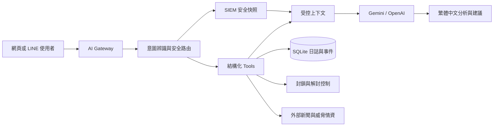

# 智慧守網精靈：SOC AI Agent 功能介紹

## 1. 功能定位

智慧守網精靈內建一套面向安全營運中心（SOC）的 AI Agent。它不是將整份日誌或資料庫直接交給大型語言模型，而是由本機程式先建立範圍受控的安全快照、辨識使用者意圖、呼叫必要工具，再由 Gemini 或 OpenAI 模型負責解釋證據、歸納風險與提出下一步建議。

此架構的主要目的如下：

- 讓分析人員使用自然語言查詢 SIEM 日誌、事件、封鎖狀態與外部情資。
- 限制每次送入模型的資料量，降低 Token 消耗及敏感資料外傳風險。
- 將外部新聞、威脅情資與本機 SIEM 證據分開呈現，避免錯誤建立因果關係。
- 將封鎖、解除封鎖等高風險操作維持在可驗證、可稽核的程式流程中。
- 以結構化 Tool Calling 為基礎，保留封裝成 MCP Server 的擴充能力。

## 2. Agent 整體架構



主要元件：

1. **AI Gateway**：統一服務網頁對話與 LINE，管理模型供應商、模型名稱、API Key、提示詞與重試機制。
2. **安全快照（Security Snapshot）**：將大量日誌彙整為固定欄位與有限筆數的安全摘要。
3. **Tool Calling 層**：以 LangChain `@tool` 定義工具名稱、用途、輸入與輸出，重用既有 SIEM 邏輯。
4. **外部 AI Provider**：目前可介接 Gemini 或 OpenAI，模型只接收快照及本輪必要的工具結果。
5. **本機資料層**：SQLite 保存日誌、事件、規則、情資、封鎖清單、對話設定與稽核紀錄。

## 3. 一次提問的執行流程

使用者送出問題後，系統依序執行：

1. **辨識意圖**：判斷問題屬於本機 SIEM、特定 IP、系統狀態、封鎖操作、資安新聞、風險 IP、釣魚網站或跨資料關聯。
2. **選擇最小資料範圍**：一般問題只使用安全快照；指定 IP 時，才補查該 IP 最新 50 筆日誌與最新 20 筆事件。
3. **呼叫必要工具**：只取得回答本輪問題所需的資料，不把完整資料庫放入模型上下文。
4. **建立受控提示詞**：提示詞明確區分「本機 SIEM 證據」與「外部情資」，並帶入時間範圍、版本與資料上限。
5. **模型生成回答**：模型根據已提供的證據產生結論、數據依據及下一步建議；資料不足時必須明確說明。
6. **產生動態建議提問**：系統依目前事件、主要攻擊、新聞快取、受影響服務及對話進度，提供下一輪可直接點選的問題。

封鎖與解除封鎖不交由模型自由決定。AI Gateway 會先比對明確指令、驗證 IP 格式，再呼叫固定工具並留下稽核紀錄。

## 4. SIEM 安全快照

安全快照由本機資料庫即時計算，預設以最近 1 小時為統計範圍，並設有 30 秒短期快取。快照不包含完整原始日誌，而是提供下列摘要：

- 快照產生時間 `generated_at`
- 統計時間範圍 `time_range_hours`
- 可追溯版本 `context_version`
- 總流量、攻擊流量、來源 IP 數及攻擊比例
- 事件狀態與未結案事件嚴重度
- WAF 與 ML 偵測筆數
- 前 5 名攻擊類型
- 前 5 名高風險來源 IP
- 前 8 名受影響服務
- 前 8 筆未結案事件
- 已啟用服務及偵測規則數量

`context_version` 由快照內容產生雜湊，可用來辨識回答所依據的資料版本。未結案事件採「所有時間的工作佇列」，流量統計則依指定時間範圍計算，兩者在提示詞中分開標示。

### 特定 IP 補查

當問題包含 IP 且要求調查時，系統才額外查詢：

- 該 IP 最新 50 筆事件日誌。
- 該 IP 最新 20 筆關聯事件。
- 時間、服務、連接埠、攻擊分類、偵測來源、HTTP 方法、URL 與狀態碼。

這種按需補查方式能避免每次對話都載入大量原始資料。

## 5. Tool Calling 功能

目前工具定義於 `assistant/tools.py`，以 LangChain Structured Tools 形式封裝。AI Gateway 會依使用者意圖選擇工具，工具回傳結果再作為模型的受控上下文。

| Tool | 功能 | 資料來源與限制 |
|---|---|---|
| `check_ip_reputation` | 查詢指定 IP 的信譽、地理位置、ASN、ISP 與本機封鎖狀態 | AbuseIPDB 為選用 API；IPinfo 提供免金鑰基本資料 |
| `ban_ip_address` | 封鎖指定 IP | 驗證 IPv4 格式後更新本機封鎖清單、服務規則及稽核紀錄 |
| `unban_ip_address` | 解除指定 IP 的封鎖 | 使用固定程式流程更新規則並留下稽核紀錄 |
| `list_blocked_ips` | 列出目前封鎖清單 | 讀取本機統一封鎖資料，包含範圍、日期與原因 |
| `get_recent_attack_logs` | 查詢最近攻擊紀錄 | 只回傳本機 SIEM 最新 5 筆攻擊偵測 |
| `get_system_status` | 查詢平台狀態 | 回傳收集器、日誌、攻擊、封鎖數量等本機狀態 |
| `search_security_knowledge` | 一般資安知識查詢介面 | 本機 RAG／Ollama 已停用，目前會提示使用外部 AI Provider |
| `list_security_news` | 列出近期資安新聞 | 最多回傳 10 則本機新聞快取，保留固定新聞 ID |
| `read_security_news` | 依新聞 ID 讀取指定新聞 | 取得標題、來源、日期、URL 與最多 2,500 字純文字摘要 |
| `list_risk_ips` | 查詢近期風險 IP | 最多回傳 20 筆 Tor Exit Nodes／FireHOL Level 1 本機快取 |
| `list_phishing_sites` | 查詢近期釣魚網站 | 最多回傳 20 筆 OpenPhish 快取；網址遮罩且不主動造訪 |
| `correlate_intel_with_siem` | 將外部 IP 情資與本機紀錄交叉比對 | 最多回傳 20 筆命中結果、事件數、最後時間及受影響服務 |

### 5.1 查詢型工具

查詢型工具只讀取本機 SIEM 或已同步的外部資料，不直接修改防禦狀態。所有工具都有筆數上限，避免回傳內容過大。

### 5.2 操作型工具

`ban_ip_address` 與 `unban_ip_address` 會產生系統副作用，因此採確定性流程：

1. AI Gateway 先確認使用者輸入符合明確的封鎖或解封語句。
2. 工具驗證 IPv4 格式。
3. 本機封鎖模組更新統一清單及對應服務規則。
4. 系統寫入操作稽核紀錄。
5. 模型只負責說明結果，不是防火牆變更的最終執行者。

## 6. 外部情資與新聞

### 6.1 風險 IP

系統可同步以下免金鑰公開清單：

- **Tor Exit Nodes**：標記匿名代理出口，預設信心分數 55。
- **FireHOL Level 1**：彙整高風險來源 IP，預設信心分數 80。

同步後資料保存於本機 `intelligence` 資料表，Agent 查詢時不必再次下載完整清單。

### 6.2 釣魚網站

系統從 OpenPhish 匯入小型 URL 清單，預設最多 300 筆。Agent 只讀取本機快取，輸出時會：

- 遮罩 URL，避免使用者誤點。
- 顯示 Host、來源、信心分數及最後同步時間。
- 依 URL 關鍵字初步區分帳號／憑證竊取、金融／付款詐騙、物流冒用或未分類釣魚網站。
- 明確註記分類屬於本機特徵初判，不會主動連線到釣魚網站。

### 6.3 資安新聞

新聞來源目前包含 Google News 台灣資安 RSS 與 iThome 資安 RSS，最多快取 100 則。查詢流程分成兩階段：

1. `list_security_news` 先回傳最多 10 則標題、來源、日期及固定新聞 ID。
2. 使用者輸入「查看新聞 #ID」後，`read_security_news` 才讀取指定新聞的有限內容。

分階段讀取可避免一次將大量文章送入模型，也讓後續提問可以穩定指向同一則新聞。若來源無法讀取正文，系統會回退使用 RSS 摘要；不會自行補造文章內容。

### 6.4 情資與 SIEM 關聯

`correlate_intel_with_siem` 會以 IP 作為可驗證的關聯鍵，將本機風險情資與事件日誌交叉比對，回傳：

- 情資來源與信心分數。
- 本機命中事件數。
- 最後一次活動時間。
- 曾接觸的受保護服務。

外部新聞不會自動被視為本機事件。只有出現相同 IP、網域、服務或其他明確證據時，Agent 才能說明可能的關聯；否則必須分別標示為「外部情資」與「本機 SIEM 證據」。

## 7. MCP 的使用方式

### 7.1 目前實作狀態

目前系統在同一個應用程式內使用 LangChain Structured Tools，尚未另外啟動獨立的 MCP Server。每個工具已具備 MCP Tool 所需的核心元素：

- 穩定且唯一的工具名稱。
- 清楚的用途描述。
- 結構化輸入參數。
- 有界限的輸出格式與筆數。
- 查詢型與操作型工具的權限區隔。
- 錯誤訊息及稽核紀錄。

因此目前可描述為「採 MCP 概念設計、具備 MCP 封裝能力」，不應描述成已對外提供 MCP Server。

### 7.2 MCP 對應設計

未來封裝 MCP Server 時，可依 MCP 的能力模型分成：

#### Tools

- `check_ip_reputation`
- `get_recent_attack_logs`
- `get_system_status`
- `list_security_news`
- `read_security_news`
- `list_risk_ips`
- `list_phishing_sites`
- `correlate_intel_with_siem`
- 經權限保護的 `ban_ip_address` 與 `unban_ip_address`

#### Resources

- `siem://snapshot/{hours}`：指定時間範圍的唯讀安全快照。
- `siem://incidents/open`：未結案事件工作佇列。
- `siem://intel/news`：新聞快取索引。
- `siem://intel/risk-ips`：風險 IP 快取。
- `siem://intel/phishing`：遮罩後的釣魚網址資料。

#### Prompts

- 安全總覽分析。
- 指定 IP 調查。
- 事件優先順序整理。
- 新聞影響分析。
- 外部情資與本機證據核對。

### 7.3 MCP 權限原則

- 安全快照、新聞及情資應預設為唯讀能力。
- 封鎖與解封必須要求已登入身分、角色權限及明確確認。
- 每次具副作用的工具呼叫都必須記錄操作者、參數、時間與結果。
- MCP Server 不應直接暴露 SQLite、原始日誌檔或 API Key。
- 回傳資料應維持現有筆數限制、網址遮罩及敏感欄位過濾。

## 8. Token 與資料治理

系統透過以下方式控制模型成本與資料範圍：

- 不傳送完整日誌，只傳送安全快照及按需查詢結果。
- 對話歷史只保留最近 6 筆內容進入模型提示詞。
- 特定 IP 最多補查 50 筆日誌及 20 筆事件。
- 新聞清單最多 10 則，單篇正文摘要最多 2,500 字。
- 風險 IP、釣魚網站及關聯結果各自設有 20 筆上限。
- 模型輸出上限目前設定為 1,200 Tokens。
- Gemini 回應異常時具有限次重試與備援模型機制。
- API Key 保存於本機設定或環境變數，不會透過設定 API 回傳明文。

若企業要求資料不得離開內部環境，可保留相同 Tool／MCP 介面，將模型供應端替換為內部模型服務；工具層、快照格式與權限控制不需跟著重寫。

## 9. 動態建議提問

系統會依安全快照及對話進度，自動產生三個優先建議問題。例如：

- 有 Critical 事件時，優先建議整理事件處置順序。
- 有主要攻擊類型時，建議分析來源、受影響服務與風險。
- 已同步新聞時，建議列出近期重要新聞並保留新聞 ID。
- 指定 IP 後，建議整理活動時間軸及評估是否封鎖。
- 討論新聞後，建議查看指定新聞或核對本機是否存在關聯證據。
- 討論攻擊手法後，依調查階段切換為原理、影響範圍、規則調整及防禦驗證。

建議內容不是固定範本，而是由目前的事件數、嚴重度、攻擊類型、受影響服務、新聞快取及歷史提問共同決定。

## 10. 使用範例

```text
最近 1 小時有哪些主要攻擊？
調查 203.0.113.34 的活動，並評估是否需要封鎖。
目前有哪些 Critical 事件尚未處理？
列出近期值得關注的資安新聞，保留新聞 ID。
查看新聞 #3，整理受影響對象、攻擊手法與防禦建議。
列出近期釣魚網站的主要類型。
風險 IP 清單有沒有命中我們的 SIEM 日誌？
比較最近 1 小時 WAF 與 ML 的偵測結果。
封鎖 203.0.113.34
解除封鎖 203.0.113.34
```

## 11. 實作檔案對照

| 功能 | 主要程式檔案 |
|---|---|
| AI Provider、提示詞與意圖路由 | `ai_gateway.py` |
| Tool Calling 定義 | `assistant/tools.py` |
| 安全快照與動態建議提問 | `siem/security_context.py` |
| 新聞、風險 IP 與釣魚資料同步 | `siem/feeds.py` |
| IP 信譽查詢 | `assistant/threat_intel.py` |
| IP 封鎖、分服務範圍與稽核 | `assistant/enforcer.py` |
| 日誌、事件、規則與情資儲存 | `siem/store.py` |
| 網頁及 LINE 共用 Agent 入口 | `ai_gateway.py`、`assistant/agent.py` |

---

本文件依目前程式實作整理。若後續正式部署 MCP Server，應再補充 MCP 傳輸方式、身分驗證、Tools／Resources URI、授權流程及 Client 設定範例。
